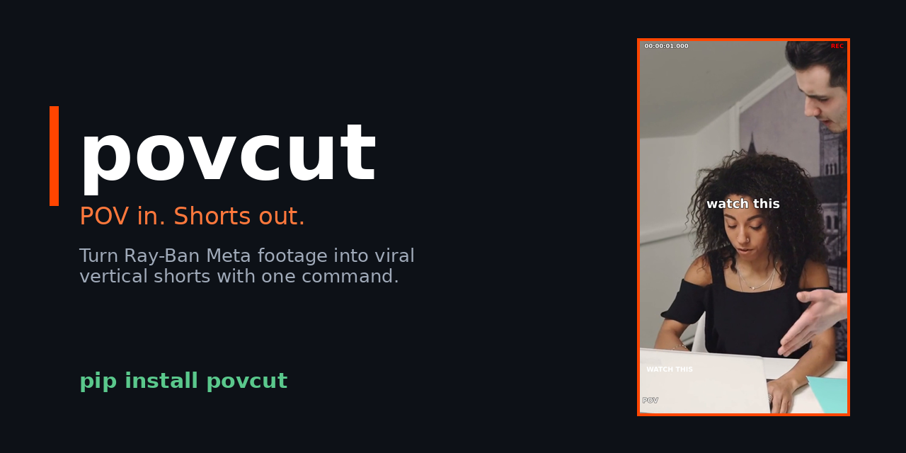
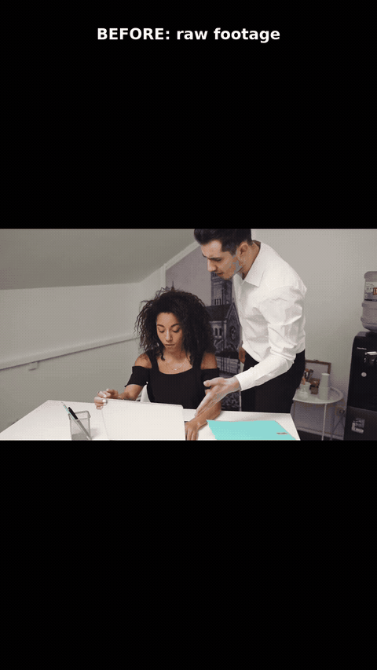
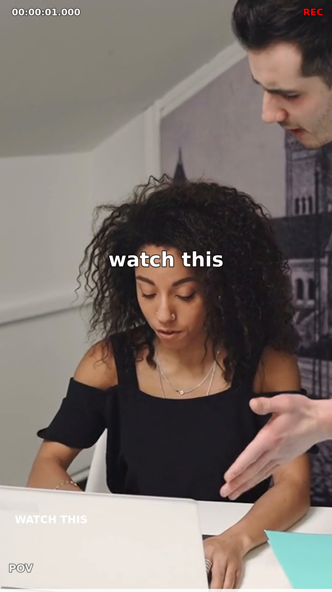
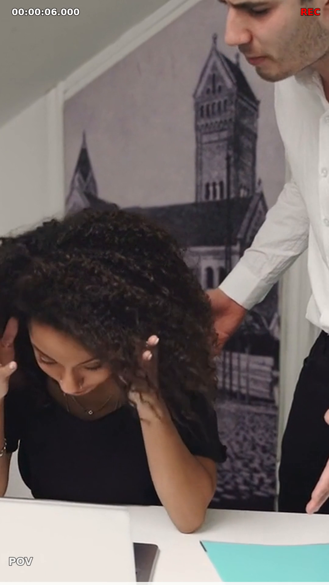
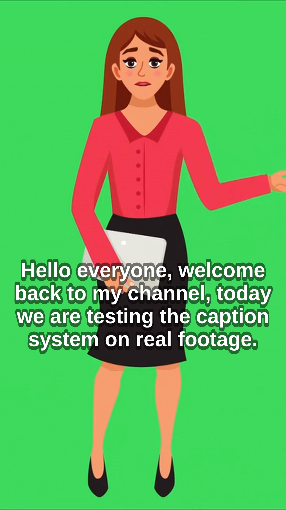

<p align="center">
  
  <p align="center"><strong>Turn Ray-Ban Meta footage into viral shorts with one command.</strong></p>
  <p align="center">
    <a href="https://github.com/hydope/povcut/actions"></a>
    <a href="https://pypi.org/project/povcut/"></a>
    <a href="LICENSE"></a>
  </p>
</p>

Your glasses record for hours. Nobody watches hours. **povcut** finds the 30 seconds worth posting, cuts them into vertical 1080×1920 shorts with captions, and packs each one with a ready-to-paste caption and hashtags.

```bash
pip install povcut          # needs ffmpeg on your PATH
povcut pipeline ~/footage   # import -> find moments -> cut -> pack. done.
```

One folder of POV footage in, a folder of ready-to-post shorts out:

```
shorts/
  pov_day_moment0_s68/
    clip.mp4      # vertical 1080x1920, burned-in captions
    thumb.jpg     # thumbnail
    caption.txt   # post text + hashtags, ready to paste
```

## Demo

Real footage (stock, via Pixabay), real pipeline: the raw clip goes in, `povcut pipeline --hud tactical` finds the moment, tracks the faces, adds the hook — and packs a ready-to-post Short.



Full-quality version: [demo.mp4](demo/demo.mp4). Every frame of the "after" was produced by the tool, nothing was hand-edited.

| Hook title card | Tactical HUD | Burned-in captions |
|---|---|---|
|  |  |  |

## For IRL streamers

Stream for six hours, wake up to your best moments as Shorts:

```bash
povcut import --watch ~/stream-vods   # auto-imports as VODs land
povcut pipeline ~/Videos/POVCut --top 5 --hud tactical
povcut post shorts/best_moment/clip.mp4 --at "tomorrow 9am"
```

Your loudest reactions, biggest plays, and funniest moments — found, cut, captioned, and scheduled while you sleep. Works on glasses footage, phone VODs, or any video file.

## Getting footage off your glasses

povcut starts wherever your footage lands:

- **Meta AI app** → export/share clips to your phone, then sync that folder to your computer (iCloud, Google Drive, Syncthing, USB — anything).
- Point `povcut import --watch <that folder>` at it once. Every new capture is imported, deduped, and date-organized automatically from then on.

## Why this exists

Every open-source project for Ray-Ban Meta glasses is a developer tool: de-metaified clients, voice bridges to your own agent, IRL streaming rigs, file converters. All brilliant. None of them helps with the thing the glasses are actually *for* — making content.

POV creators shoot for hours and edit for longer. povcut kills the scrubbing:

- **moments** — ranks every candidate moment 0–100 by audio energy (laughter, reactions, applause), scene changes, faces on camera, and Shorts-length fit. The loud bits float to the top.
- **cut** — 9:16 crop with **per-frame face tracking** (the window glides after your subject; needs the `vision` extra, else a clean static crop), karaoke-style burned-in captions, 30 fps, platform-ready H.264.
- **HUD overlays** — tactical or minimal themes: REC bug, running timecode, progress bar, kinetic lower-third, and an auto hook title card ("wait for it…") in the first 1.5 s. The "how did you film that?" layer.
- **spin** — rewrites *any* clip into the Ray-Ban Meta capture structure so Instagram treats it as glasses footage and enables **Spin View**. Yes, even phone footage.
- **pack** — every clip ships with a thumbnail, a caption, and hashtags. Paste and post.
- **post** — dual-track publishing via the shared [creator-publish](https://github.com/hydope/creator-publish) package: **Track A** — official APIs (YouTube first, then TikTok/Instagram/X/Threads/Bluesky/LinkedIn/Pinterest/Facebook), BYO keys, scheduled in plain English. **Track B** — a native-posting handoff pack for creators who'd rather post from the app itself.
- **stats/tune** — an honest experiment: post performance is recorded from day one, and per-creator scoring weights tune themselves only after enough real data exists (≥50 posts, ≥60 days — enforced in code, with kill criteria if there's no signal).

## Install

```bash
pip install povcut
# optional: face-following crop
pip install "povcut[vision]"
# optional: fully on-device auto captions (free, no API key)
pip install "povcut[auto-captions]"
```

You need `ffmpeg` and `ffprobe` on your PATH ([download](https://ffmpeg.org/download.html)).

## Usage

```bash
# the one-command happy path
povcut pipeline ~/MetaAIFootage --top 3

# or step by step
povcut import ~/MetaAIFootage            # deduped, date-organized library
povcut moments clip.mp4 --top 5         # ranked moments with reasons
povcut cut clip.mp4 --top 3             # vertical shorts + packs
povcut cut clip.mp4 --hud tactical      # the comment-bait overlay look
povcut cut clip.mp4 --captions auto     # with on-device transcription
povcut cut clip.mp4 --captions subs.srt # or your own .srt, burned in
povcut spin phone_clip.mp4              # Spin View-ready _SPIN.MOV

# publish (needs: pip install creator-publish)
povcut post clip.mp4 --dry-run                      # validate, post nothing
povcut post clip.mp4 --title "POV: ..."             # YouTube via official API
povcut post clip.mp4 --at "Friday 6pm"              # scheduled, plain English
povcut post clip.mp4 --handoff                      # Track B: native-posting pack
povcut worker                                       # run the publish queue
povcut stats                                        # recorded performance
povcut tune                                         # refuses until enough data
```

`povcut moments` prints something like:

```
[0]     8.0s ->    16.0s  score  67.9  (loud moment (laughter / reaction / applause))
[1]     0.0s ->     6.0s  score  31.7  (scene change)
[2]    18.0s ->    24.0s  score  31.7  (scene change)
```

## How the viral score works

No black box. Each moment gets 0–100 from three honest signals:

| Signal | Weight | What it measures |
|---|---|---|
| Loudness | 45% | RMS energy vs. the clip's own baseline — laughter, gasps, applause |
| Length fit | 30% | 15–45 s is the Shorts/TikTok sweet spot |
| Faces | 25% | fraction of frames with a face on camera (skipped gracefully without the `vision` extra) |

Reasons are printed next to every score, and the full ranking lands in `moments.json` if you want to build on it.

## Spin View, explained

Instagram decides a video "came from Meta glasses" by reading its QuickTime structure, not its pixels. `povcut spin` rewrites any clip into that structure: QuickTime container with the `qt  ` brand, `ftyp`/`wide`/`mdat`/`moov` order, the `meta` atom as a direct child of `moov` with the glasses' `com.apple.quicktime.*` fields, the `tapt` atom, Core Media handler names, HEVC `hvc1` at 1376×1840 / 30 fps, movie timescale 48000, AAC 48 kHz stereo — chunk offsets repointed so the file stays valid.

The structural recipe was reverse-engineered by the public **[metaspin](https://github.com/loui89/metaspin)** project (MIT), which compared rebuilds against genuine Ray-Ban Meta Gen 2 captures and verified Spin View on a real account. povcut's `spin` module is an independent implementation of that documented structure, with credit where it's due. No serial numbers or device identifiers are copied — only the shared structure both files have in common.

After every conversion, `povcut spin` runs a structural self-check (atom order, meta keys, tapt, timescales, chunk offsets inside `mdat`) and refuses to call it done if anything is off.

## Roadmap

- [x] HUD overlays + hook title cards
- [x] Per-frame face-tracking crop
- [x] Dual-track publishing via the shared creator-publish package
- [x] Performance stats + tuning experiment (kill criteria enforced in code)
- [ ] Auto hook titles from transcription, not just moment reasons
- [ ] True camera-roll push (companion app)
- [ ] Live mode: clip moments during a stream, not after

## Contributing

PRs welcome. The test suite generates its own synthetic footage and runs the whole pipeline — `python -m unittest discover -s tests`. No API keys, no accounts, no network needed.

## License

MIT. Not affiliated with, endorsed by, or sponsored by Meta Platforms or EssilorLuxottica.
